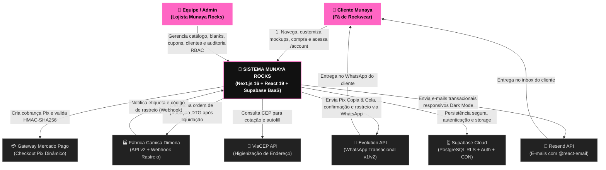
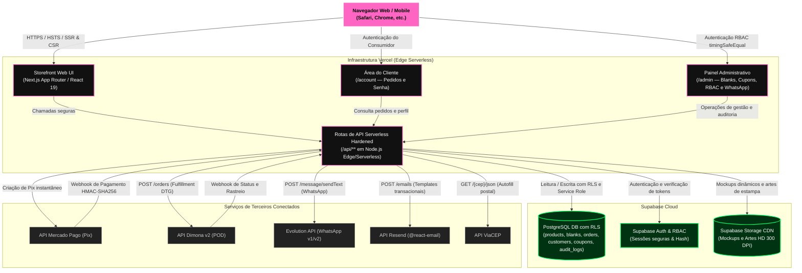
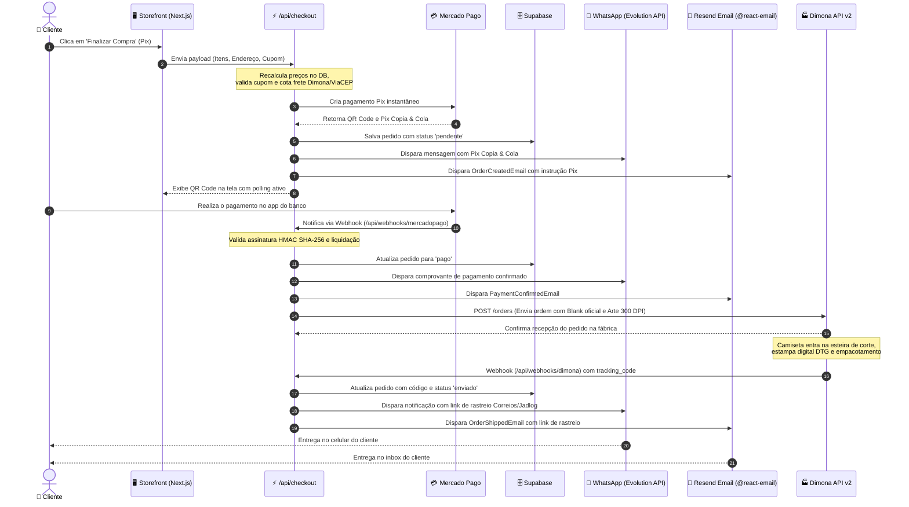

# 📐 Arquitetura C4 da Plataforma Munaya Rocks

Documentação arquitetural baseada no modelo **C4 (Context, Container, Component, Code)** para visualização detalhada da plataforma de e-commerce Munaya Rocks.

---

## Nível 1: Diagrama de Contexto de Sistema (Context Diagram)

O diagrama de contexto detalha como os clientes e o lojista interagem com a plataforma Munaya Rocks e como o sistema se integra aos serviços externos parceiros.

---

## Nível 2: Diagrama de Contêineres (Container Diagram)

Detalha as aplicações, bancos de dados, storages e fronteiras de rede que compõem o ecossistema Munaya Rocks.

---

## Nível 3: Diagrama de Componentes da Aplicação (Component Diagram)

Visão interna dos módulos de software organizados dentro da aplicação Next.js:

```mermaid
flowchart TD
    classDef core fill:#111111,stroke:#ff66c4,stroke-width:2px,color:#ffffff;
    classDef lib fill:#222233,stroke:#66aaff,stroke-width:2px,color:#ffffff;
    classDef notify fill:#064e3b,stroke:#059669,stroke-width:2px,color:#ffffff;
    classDef security fill:#441111,stroke:#ff3333,stroke-width:2px,color:#ffffff;

    subgraph CONTROLLERS["API Route Handlers (src/app/api)"]
        CHK["/api/checkout"]:::core
        SHP["/api/shipping"]:::core
        ORD["/api/orders"]:::core
        PRD["/api/products"]:::core
        CPN["/api/coupons"]:::core
        PRC["/api/pricing"]:::core
        CST["/api/customers"]:::core
        WA_CFG["/api/whatsapp/config"]:::core
        WMP["/api/webhooks/mercadopago"]:::core
        WDM["/api/webhooks/dimona"]:::core
    end

    subgraph LOGIC["Módulos de Domínio & Negócio (src/lib)"]
        LIB_DIM["dimona.ts & dimona-mapping.ts<br/>(SKUs de Blanks & Fulfillment)"]:::lib
        LIB_PRC["pricing.ts<br/>(Motor de Markup & Margens)"]:::lib
        LIB_CPN["coupons.ts<br/>(Motor de Descontos & Validade)"]:::lib
        LIB_DB["supabase.ts<br/>(Data Access Layer & Schemas)"]:::lib
    end

    subgraph NOTIFICATION["Disparadores de Mensageria Multicanal"]
        LIB_WA["whatsapp.ts<br/>(Evolution API v1/v2 + Fallback wa.me)"]:::notify
        LIB_EML["email.ts<br/>(Templates @react-email via Resend)"]:::notify
    end

    subgraph SECURITY_LAYER["Camada de Segurança & AppSec"]
        SEC_AUTH["admin-auth.ts & audit.ts<br/>(timingSafeEqual & Log RBAC)"]:::security
        SEC_HMAC["mp-webhook-auth.ts<br/>(HMAC SHA-256 Signature)"]:::security
        SEC_RATE["rate-limit.ts<br/>(Anti-Brute Force Protection)"]:::security
        SEC_SAN["sanitize.ts<br/>(Anti-XSS & String Sanitizer)"]:::security
    end

    CHK --> SEC_RATE
    CHK --> SEC_SAN
    CHK --> LIB_PRC
    CHK --> LIB_CPN
    CHK --> LIB_DB
    CHK --> LIB_WA
    CHK --> LIB_EML

    SHP --> SEC_RATE
    SHP --> LIB_DIM

    WMP --> SEC_HMAC
    WMP --> LIB_DB
    WMP --> LIB_DIM
    WMP --> LIB_WA
    WMP --> LIB_EML

    WDM --> LIB_DB
    WDM --> LIB_WA
    WDM --> LIB_EML

    ORD --> SEC_AUTH
    ORD --> LIB_DB

    PRD --> SEC_AUTH
    PRD --> LIB_DB

    CPN --> SEC_AUTH
    CPN --> LIB_CPN

    PRC --> SEC_AUTH
    PRC --> LIB_PRC

    WA_CFG --> SEC_AUTH
```

---

## Nível 4: Diagrama de Sequência de Compra, Produção e Notificação

Fluxo ponta a ponta desde o clique de compra até a entrega do código de rastreamento pelos dois canais:

